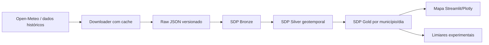

# ClimateWatch — monitoramento experimental de chuvas e extremos climáticos

**Arquivo:** prompt de implementação para OpenAI Codex · **Atualização:** 09/11/2026 · **Idioma:** PT-BR · **Ambiente:** Ubuntu 24.04 LTS

**Destino:** projeto novo (dados públicos + backfill)  
**Pacote Python sugerido:** `climatewatch`  
**Objetivo:** aprender com fases verificáveis, documentar e publicar uma série de **cinco posts (1/5 a 5/5)** no LinkedIn.

**LEIA ANTES DE EXECUTAR:** entregue a seção “PROMPT PRINCIPAL” inteira ao Codex no diretório correto. Ele deverá executar **apenas a FASE 0** na primeira execução. Os textos de posts são rascunhos; não afirmar números sem teste e não publicar automaticamente.

# ESPECIFICAÇÃO DO PROJETO — CLIMATEWATCH

## Problema e proposição

Criar um produto de dados geotemporal para **explorar** padrões de temperatura, chuva e extremos em localidades brasileiras; usar dados abertos, visualizações, análises de tendência e limites transparentes. Este sistema **não é alerta oficial**, não prevê enchentes por si só e não substitui Defesa Civil/INMET/CEMADEN.

**Pitch:** “Como desenhar um pipeline confiável para dados ambientais, do backfill histórico a um mapa interativo e a regras experimentais de observação”.

## Onde baixar e como usar os dados

1. Fonte principal: Open-Meteo — documentação de clima histórico https://open-meteo.com/en/docs/historical-weather-api . Endpoint de referência: `https://archive-api.open-meteo.com/v1/archive` (consultar parâmetros reais na documentação). Usar localização + intervalo + variáveis como `temperature_2m`, `precipitation`, `relative_humidity_2m`, `wind_speed_10m`, `time`. Atribuir fonte e checar termos de **uso gratuito não comercial**, limites e CC BY 4.0; não usar como fonte de observação direta de estação se forem dados de reanálise/modelo.
2. Para separar **histórico observado/modelado** de **previsão futura**, consultar https://open-meteo.com/en/docs e só habilitar previsão após validar endpoint e metodologia. Nunca chamar os dados históricos de “previsão”.
3. Fonte complementar a avaliar: INMET https://portal.inmet.gov.br/dadoshistoricos — consultar arquivos, termos e diferenças entre estações observadas e grade de modelo. Começar com Open-Meteo para reduzir incerteza, sem misturar origens sem coluna de proveniência.
4. Criar `scripts/download_weather.py` com `--location-id`, `--start`, `--end`, `--variables`, cache, TTL, Retry-After, timeouts, backoff, rate limit e logs. Persistir JSON de origem + metadata e fixture local. Não fazer chamada HTTP nos decorators SDP.

## Modelo analítico

- `location_id`, nome e coordenadas **de localidades públicas**, timezone IANA, fonte/modelo, `measurement_time` UTC, `ingested_at`, `temperature_c`, `precipitation_mm`, `humidity_pct`, `wind_speed_kmh`, `quality_flags`, versionamento do contrato. Definir o que é acumulado horário versus instantâneo e unidades de origem.
- Municípios-piloto para estudo: 3 localidades documentadas com suas coordenadas verificadas; evitar coordenadas inventadas e usar Open-Meteo Geocoding ou fonte pública. Configurável para crescer em um segundo momento.
- **Bronze:** resposta de API íntegra, timestamp de coleta, ID de request, hash e parâmetros. **Silver:** explode por local/hora, unidades, fuso, nulos e unicidade `(location_id, measurement_time, source, variable/model)`. **Gold:** totais diários de precipitação, máximas e médias, séries móveis, ranking regional e indicadores exploratórios com período explícito.
- Regras ilustrativas: alerta local configurável se precipitação em janela de 24h superar limiar **escolhido para demo**, sem classificá-lo como risco hidrológico oficial. Documentar falsos alarmes e limites de precisão espacial.

## Arquitetura proposta



- Primeiro **batch incremental** por datas, sem Kafka: é tecnicamente mais fiel à API. Só adicionar Kafka se criar um caso de uso real de streaming/polling com event time/replay, registrando ADR de custo-benefício.
- Interface: mapa interativo e série temporal por cidade, filtros de intervalo, créditos à fonte, escala e unidade; indicar período e resolução do modelo. Não usar mapa de risco oficial nem enviar alertas a pessoas por padrão.
- Módulo opcional: comparação de dados INMET e Open-Meteo com MAE, MAPE apenas quando denominador fizer sentido, cobertura temporal e justificativa das diferenças. Não treinar modelo de previsão sem avaliação temporal e benchmark ingênuo.

## Testes e critérios de aceite

1. Backfill de pelo menos 30 dias para 3 localidades verificadas; permitir execução offline com fixture pequena.
2. Reexecução do mesmo intervalo sem duplicar Silver/Gold; testar troca de fuso e horário de verão em fixture controlada, nulos e horas faltantes.
3. Conferir totals diários em datas conhecidas e timezone correto; comparar agregação Spark com cálculo manual do teste, não com números chutados.
4. Fazer o pipeline SDP gerar Bronze/Silver/Gold e dashboard utilizável com seleção de local e período.
5. Mostrar diferenças entre dados de reanálise e medições de estação; evitar inferir causalidade/clima futuro a partir de poucas semanas.

## Decisões de implementação

Prefira API + cache + execução em janelas a consultar a mesma fonte em loop sem necessidade. Usar guardrails de volume e persistência incremental; adotar Kafka apenas como experimento de extensão justificado. Tratar falhas de disponibilidade e qualidade com transparência.

---

# PROMPT PRINCIPAL PARA O CODEX — EXECUÇÃO CONTROLADA

> **LEIA ANTES DE EXECUTAR.** Este é um programa completo, não um pedido para implementar tudo em uma única execução. Nesta primeira interação, **execute apenas a FASE 0** (auditoria, plano e provas de viabilidade). Não crie infraestrutura pesada nem avance para a FASE 1 sem meu comando explícito. Ao concluir uma fase, registre evidências e pare. Não prometa trabalhar em segundo plano.

## Papel e objetivo

Atue como uma equipe de engenheiro de dados sênior, arquiteto de sistemas distribuídos, especialista em Spark Declarative Pipelines (SDP), especialista em Python/Clean Architecture/SOLID, SRE, especialista em qualidade de dados, revisor de segurança, professor e editor técnico. Desenvolva o projeto descrito acima como **laboratório de estudos reproduzível e portfólio técnico**; todo resultado deve ser verificável localmente e compreensível para um leitor.

**Ambiente-alvo:** Ubuntu 24.04 LTS, Python 3.12+ quando compatível, Docker Compose, Git, máquina pessoal com RTX 2070 (GPU opcional; jamais exigir CUDA para o MVP). Priorize baixo custo, limites de memória/CPU, execução offline por fixtures e zero dependência obrigatória de nuvem/Databricks. Use versões fixadas após validação de compatibilidade; não presuma que a última versão de todas as bibliotecas combina.

**Idioma:** explicações, documentação, comentários, docstrings, mensagens de commit sugeridas, dashboards e posts em português do Brasil. Nomes técnicos, imports e contratos podem ficar em inglês. Código Python com type hints, docstrings Sphinx em **todas as funções/métodos e classes públicas**, testes e comentários explicando decisões não triviais (sem comentar linhas óbvias). Não use orientação a objetos só por estilo: classes quando houver estado, múltiplas implementações ou invariantes; funções puras para transformação simples.

## Regras não negociáveis

1. **Inspecione antes de alterar.** Leia README, instruções AGENTS.md do projeto, dependências, testes, scripts, compose, documentação, diagramas, situação do Git e licenças. Preserve código funcionando. Se for um diretório vazio, declare que é greenfield.
2. **Sem invenções:** não afirme que uma API existe, que um dado está disponível, que uma métrica foi obtida ou que um teste passou sem verificação. Se não houver internet ou ambiente, sinalize a limitação e use fixtures representativas rotuladas como sintéticas.
3. **No SDK errado:** Spark SDP open source é declarado via `from pyspark import pipelines as dp` e executado por `spark-pipelines`; não confunda com recursos exclusivos do Databricks Lakeflow, `dlt` ou sintaxe de edição diferente. Verifique versão, conectores e recursos efetivos na documentação oficial. Guia: https://spark.apache.org/docs/latest/declarative-pipelines-programming-guide.html .
4. **Separe o SDP de ingestão externa e de efeitos colaterais.** A coleta HTTP, a geração de eventos, a publicação Kafka, treinamento ML, alertas e chamadas a serviços externos devem ficar em adapters/jobs idempotentes. As funções declarativas SDP devem retornar DataFrames e não fazer `collect` irrestrito, writes ocultos, mutações de sessão ou chamadas a APIs HTTP dentro de decorators.
5. **Prove a operação:** `spark-pipelines dry-run` testa análise/definições, **não** lê nem grava dados; execute também `spark-pipelines run` com fixture apropriada e valide o conteúdo gerado. Antes de implementar uma fonte Kafka/objeto, confira os JARs/versões Java, Scala, Spark, Hadoop/S3A e testes de integração.
6. **Segurança:** sem segredos versionados, sem credenciais no log, sem informações pessoais reais, `.env.example`, `.gitignore`, princípios de menor privilégio, origem e licença dos dados preservadas; obtenha aprovação antes de deleções, `git reset`, grandes downloads, alterações destrutivas de banco ou push. Não publique nada automaticamente no LinkedIn nem em produção.
7. **Qualidade:** nunca mascarar exceções; identificar reprocessamento, event time versus processing time, horário UTC, schema drift, duplicatas, late arrivals, watermarks, lacunas, DLQ/quarentena, auditoria, linhagem e consistência. Documente limites da semântica exactly-once, checkpoints e comportamento sob falhas.
8. **Educação:** cada fase produz uma explicação simples do que foi aprendido, as escolhas e trade-offs, comandos de reprodução e um pequeno experimento controlado. Evite superengenharia e integrações desnecessárias.
9. **Entrega incremental:** ao fim de cada fase, execute o que for possível, relate `PASSOU`, `FALHOU` ou `NÃO EXECUTADO`, com comandos e logs-resumo; atualize plano, changelog e documentação; pare aguardando o comando `Execute a FASE N`.
10. **Rastreabilidade editorial:** os posts só poderão afirmar resultados observados em testes reproduzíveis. Onde houver placeholders `[...]`, não preencha com números imaginados.

## Contrato de arquitetura e organização

Projete camadas e dependências no sentido das regras de negócio:

```text
interfaces/             # CLI, FastAPI ou dashboard; orquestra entradas/saídas
application/             # casos de uso, portas (Protocol/ABC), DTOs
 domain/                # invariantes e regras puras sem Spark, DB, Kafka ou API
infrastructure/          # adapters HTTP/Kafka/Parquet/DB/ML, configuração e observabilidade
pipelines/               # definições SDP: Bronze -> Silver -> Gold
```

Ajuste a estrutura quando a natureza dos dados justificar, sem pastas vazias só para parecer Clean Architecture. Um exemplo para repositório novo:

```text
.
├── AGENTS.md
├── README.md
├── pyproject.toml
├── .env.example
├── docker-compose.yml
├── docs/
│   ├── architecture.md
│   ├── data-contracts.md
│   ├── data-catalog.md
│   ├── decisions/0001-architecture.md
│   ├── plan.md
│   ├── runbook.md
│   ├── learning-notes.md
│   ├── sources-and-licenses.md
│   └── linkedin/01.md ... 05.md
├── src/<pacote>/domain/
├── src/<pacote>/application/
├── src/<pacote>/infrastructure/
├── src/<pacote>/interfaces/
├── pipelines/
├── scripts/
├── tests/unit/
├── tests/integration/
├── tests/contracts/
└── data/fixtures/  # dados pequenos, sintéticos e autorizados
```

**Padrões:** interfaces com `typing.Protocol` somente quando houver necessidade de desacoplamento real; DI por construtor; SRP, OCP, LSP, ISP, DIP de forma pragmática; configs tipadas; erros de domínio explícitos; `pathlib`, `logging` estruturado, UTC, formatadores; notebooks apenas para exploração, nunca como única fonte de lógica produtiva. Escolha gerenciador de pacotes (`uv` ou Poetry) e fixe lockfile; `ruff`, `mypy`/`pyright`, `pytest`, `pytest-cov` e GitHub Actions com pipeline básico. README com `make setup`, `make up`, `make test`, `make lint`, `make run-sdp`, `make down` (ou comandos equivalentes realmente testados).

**Dados:** inventário de datasets e fontes em `docs/sources-and-licenses.md`, com URL exata, licença/termos, data de acesso, esquema, volume aproximado medido, versão ou checksum, cache/retry/backoff, política de atualização e rotulagem `real`, `simulado`, `derivado`. Download automatizado com limites, parâmetros CLI e cache, mas fixture local suficiente para CI offline. Não colocar dumps gigantes no Git.

**SDP:** após testar a instalação, criar `spark-pipeline.yml` e funções `@dp.table`, `@dp.materialized_view` conforme a versão suportar; escolha streaming table só para fonte realmente incremental, materialized view para batch. Camadas Bronze (fiel à origem + metadados), Silver (schema e qualidade, dedupe e tratamentos), Gold (agregados consumíveis). Para cada tabela: contrato, chave, particionamento sensato, política de atualização, metadados de origem, métrica de qualidade e 2-3 testes. Não presumir suporte a Auto CDC, expectativas DQ nativas, Delta/Iceberg, catálogo ou sinks externos sem PoC compatível na versão escolhida; comparar alternativas e registrar ADR. Usar Spark SQL/PySpark DataFrames para transformações, evitando UDF Python onde funções nativas resolvem.

**Observabilidade:** logs com correlation_id, dataset, etapa, batch_id, event_id quando aplicável; métricas de throughput, latência, freshness, erros, registros rejeitados, consumo e taxa de retrabalho; painel mínimo com origem de cada métrica; alertas locais não enviados a terceiros por padrão. Cobertura de testes de domínio priorizada; integration tests com serviços isolados/fixtures; smoke E2E de ingestão até Gold; testes de replay/idempotência, schema evolution, dados nulos, eventos fora de ordem e timezones. Performance com conjunto pequeno e baseline documentada, sem números inventados.

**Diagramas:** mantenha `docs/architecture.md` com Mermaid de contexto, componentes e fluxo de dados. Escreva ao menos um ADR de decisão SDP versus Structured Streaming convencional e outro de armazenamento. Produza `docs/runbook.md` (subir, validar, simular falhas, recuperar, encerrar e limpar com segurança) e `docs/learning-notes.md` (o que estudei em cada fase).

## Etapas e regras de avanço

Execute **somente** a etapa solicitada. Quando eu abrir o arquivo pela primeira vez no Codex, execute a FASE 0.

### FASE 0 — Auditoria e planejamento (agora)

- Inspecionar o workspace/Git; identificar estado real, dependências e risco de incompatibilidade.
- Verificar fontes citadas neste arquivo e sua documentação, termos e esquema; se acesso externo não for possível, registrar `A VALIDAR` e criar uma estratégia de fixture.
- Criar/atualizar `docs/plan.md`: objetivo, escopo MVP versus opcionais, casos de uso, arquitetura Mermaid, riscos, ADRs, backlog priorizado com tarefas pequenas, estimativas por esforço (não por promessa de prazo), critérios de aceite e roteiro de estudo.
- Escrever `docs/learning-notes.md` iniciando por conceitos e um exercício mínimo para explicar SDP x Structured Streaming.
- Propor estrutura de repositório, matriz de compatibilidade de software, orçamento de recursos e plano de download/armazenamento. Não instalar tudo, não derrubar serviços existentes e não refatorar neste passo.
- Produzir quadro "o que já existe / o que falta / como comprovar"; destacar bloqueios; pedir apenas informações que realmente impeçam a próxima fase.

### FASE 1 — Fonte, contratos e protótipo mínimo

- Criar adapter de ingestão ou gerador conforme a especificação do projeto, com retries, limites, paginação quando necessária, cache, log e dados de exemplo.
- Criar modelos de domínio e contratos de dados (schemas versionados, exemplos válidos/inválidos, IDs/event_time, timezone, chaves e proveniência).
- Preparar persistência local mínima ou fixture e demonstrar ingestão do início ao fim sem Kafka obrigatório.
- Criar testes unitários/contratuais; documentar dados reais versus sintéticos; publicar evidência técnica para o post 1/5, sem publicar.

### FASE 2 — Engenharia de eventos e resiliência

- Se houver eventos, instrumentar Kafka/producer/consumer e fluxo de replay com idempotência e política de quarentena; se a origem for batch, implementar ingestão incremental por data/hash e **justificar por que não precisa Kafka**.
- Testar duplicação, atraso, ausência de campos, interrupção e retomada. Medir quantidades, tempo de processamento e taxa de erros localmente.
- Criar teste de falhas reproduzível e documentação das decisões. Gerar evidências para o post 2/5.

### FASE 3 — Spark Declarative Pipelines

- Criar pipeline SDP real, contendo Bronze/Silver/Gold com contratos definidos; demonstrar grafo de dependências, funcionamento batch e, quando fizer sentido, streaming.
- Rodar `spark-pipelines dry-run`, `spark-pipelines run` e consultas de validação sobre resultado persistido; registrar versão e comandos exatos, schema e amostras anônimas.
- Comparar brevemente com solução equivalente PySpark imperativa: número de etapas, responsabilidades do engine, limitações e trade-offs, sem alegar benchmarks não medidos.
- Testar idempotência/reexecução e cenários de schema drift, late data e checkpoint de acordo com a fonte. Gerar evidências para post 3/5.

### FASE 4 — Produto de dados, qualidade e demonstração

- Implementar analytics/ML/dashboards específicos abaixo, com baseline e limitações; adicionar métricas, testes e documentação de consumo da Gold.
- Gravar uma demonstração reproduzível (roteiro de vídeo curto/GIF/prints, não presumir captura automática) e produzir dados de exemplo anônimos.
- Fazer E2E e testes de regressão; registrar resultados, reprodutibilidade, limitações e decisões. Gerar evidências para post 4/5.

### FASE 5 — Publicação técnica, hardening e aprendizado

- Revisar README, quickstart Ubuntu, arquitetura Mermaid, ADRs, runbook, contratos, métricas, custos, limitações, licença e evidências.
- Rodar suíte completa possível, auditar dados/segredos, criar relatório de qualidade e checklist de demo. Não criar resultados fictícios.
- Preparar o post de encerramento 5/5, carrossel de 5 slides em Markdown (conteúdo/roteiro, não imagens falsas), vídeo de 30–60 s com roteiro, resumo de arquitetura e sugestões de próximas melhorias.
- Entregar lista curta de aprendizados, falhas, trade-offs e pendências. Não publicar no LinkedIn/GitHub sem consentimento.

## Como responder no fim de CADA fase

Em português do Brasil, apresente: (1) objetivo realizado; (2) arquivos criados/alterados; (3) decisões e alternativas; (4) comandos efetivamente executados; (5) testes e resultados, distinguindo `PASSOU`/`FALHOU`/`NÃO EXECUTADO`; (6) evidências quantitativas com fonte; (7) riscos, dívidas e custo; (8) qual o próximo comando `Execute a FASE N`. Não prossiga sozinho. Não invente trabalho futuro concluído.

## Operação editorial contínua

Crie `docs/linkedin/01.md` ... `05.md` com os **textos abaixo como RASCUNHO**, ajustando fatos somente após teste. Cada arquivo deve registrar: fase vinculada, ideia central, print/diagrama ou vídeo sugerido, título de capa, texto em 600–1.400 caracteres aproximadamente, CTA relevante, 3–5 hashtags pertinentes, link real do repositório quando publicado e evidência da afirmação técnica. Para cada post, adicionar: `Status: RASCUNHO | REVISADO | PUBLICÁVEL`, checklist de privacidade/licença e placeholder para métricas. Evitar frases de marketing vazias, números fabricados, promessas de prevenção/predição e excesso de hashtags. **Não publicar automaticamente.**

### Calendário de publicação sugerido

Publicar cada parte **depois** de a fase correspondente estar validada (não por cronograma fixo). Alternar diagrama simples, screenshot real, falha/solução e demo. Responder a comentários com detalhes técnicos e links reproduzíveis. A sequência 1/5, 2/5, ... é **por projeto**, não numeração global entre os cinco projetos.

---

# PLANO DE CONTEÚDO PARA LINKEDIN — 5 PUBLICAÇÕES

Esta sequência é independente das demais séries. Os textos estão prontos como base editorial, mas todos os trechos `[INSERIR ...]` dependem de resultados reproduzidos e devem ser preenchidos com evidências antes de publicar. Nos posts, use **1/5, 2/5, 3/5, 4/5 e 5/5**, respectivamente.

### Post 1/5 — De onde vêm os dados do clima?

**Artefato sugerido:** Visual: mapa das três cidades e tabela de proveniência.

**Rascunho para LinkedIn (personalizar depois da execução):**

> Dado climático é fácil de baixar. Difícil é explicar o que ele representa.
> 
> Comecei o ClimateWatch (1/5), um laboratório de engenharia de dados sobre temperatura e precipitação em cidades brasileiras. A primeira tarefa foi escolher a fonte, registrar licença, coordenadas, fuso horário e distinguir dados históricos de reanálise de observações feitas por estações.
> 
> Montei um contrato de dados, download com cache e uma fixture reproduzível. Não é um sistema de alerta oficial: quero estudar o caminho dos dados, com transparência sobre origem e limites.
> 
> Na parte 2/5, vou simular falhas de coleta e reprocessar períodos sem duplicar registros.
> 
> Qual fonte climática aberta você usa em projetos?
> 
> #OpenData #DataEngineering #Python #Clima

### Post 2/5 — API confiável não basta

**Artefato sugerido:** Visual: waterfall de downloads, contagem de lacunas e requisições repetidas.

**Rascunho para LinkedIn (personalizar depois da execução):**

> Uma API respondeu 200. Isso garante qualidade dos dados? Não.
> 
> No ClimateWatch (2/5), tratei coleta por intervalos, cache, timeouts, repetição controlada e lacunas de série temporal. Também separei o horário da localidade do timestamp UTC para evitar uma chuva “mudar de dia” por erro de fuso.
> 
> Na execução testada: [INSERIR AMOSTRAS/LACUNAS/PERCENTUAIS REALMENTE MEDIDOS]. O fluxo de reprocessamento usa chaves e regras explícitas; dados ausentes são visíveis, não interpolados silenciosamente.
> 
> A próxima etapa é declarar Bronze, Silver e Gold em Spark SDP.
> 
> Qual foi o bug de timezone mais difícil que você já encontrou?
> 
> #DataQuality #ETL #Python #EngenhariaDeDados

### Post 3/5 — Medallion com Spark SDP

**Artefato sugerido:** Visual: DAG das tabelas e amostra real Gold por município/dia.

**Rascunho para LinkedIn (personalizar depois da execução):**

> Quando vale a pena usar Spark Declarative Pipelines em dados de API?
> 
> ClimateWatch 3/5: transformei arquivos brutos de clima em tabelas Bronze, Silver e Gold, com contratos de unidade, unicidade e atualização incremental. Escolhi um fluxo batch com reprocessamento controlado, porque a fonte não é um stream de eventos por natureza.
> 
> Validação feita com [COMANDO] e [RESULTADO MEDIDO]. Isso me ajudou a separar uma decisão arquitetural de uma moda: nem todo projeto precisa Kafka.
> 
> A Gold agora apoia análises diárias por local, sem esconder dias sem dados.
> 
> Você colocaria Kafka nesse caso? Em qual requisito?
> 
> #ApacheSpark #PySpark #DataArchitecture #Medallion

### Post 4/5 — Do pipeline ao mapa

**Artefato sugerido:** Visual: mapa e gráfico com crédito da fonte e legenda de resolução.

**Rascunho para LinkedIn (personalizar depois da execução):**

> Um dashboard de chuva pode parecer simples — até você esquecer a escala e a origem dos dados.
> 
> No ClimateWatch 4/5, montei um mapa e séries temporais para comparar localidades. Limiares de chuva são apresentados como **experimentos exploratórios**, não como avisos da Defesa Civil.
> 
> O painel mostra período, unidade, fonte e lacunas de coleta. O resultado mais interessante do estudo foi [INSERIR INSIGHT COM DATA E FONTE].
> 
> Também registrei limites da resolução espacial e a diferença entre dados históricos modelados e previsão futura.
> 
> O que você considera obrigatório para confiar em um dashboard geográfico?
> 
> #DataVisualization #Clima #PySpark #OpenData

### Post 5/5 — Projeto aberto e limites reais

**Artefato sugerido:** Visual: vídeo 45s do download, processamento e mapa.

**Rascunho para LinkedIn (personalizar depois da execução):**

> Concluí o ClimateWatch (5/5), um laboratório que transforma dados climáticos abertos em um produto analítico reprodutível.
> 
> Arquitetura: fonte pública → download rastreável → Spark SDP Bronze/Silver/Gold → indicadores e mapa interativo. Documentei testes, datas de referência, licença, falhas de coleta e o que o projeto **não** é capaz de prever.
> 
> Métricas verificadas: [INSERIR]. Maior lição: [INSERIR APRENDIZADO].
> 
> Repositório, datasets e instruções Ubuntu: [LINK APÓS PUBLICAÇÃO].
> 
> Que melhoria agrega mais valor: comparar com estações INMET, ampliar cidades ou medir a qualidade da série?
> 
> #OpenSource #EngenhariaDeDados #ApacheSpark #DataQuality

---

# CHECKLIST EDITORIAL ANTES DE PUBLICAR

- [ ] A fase correspondente do projeto está pronta, testes executados e logs/evidências salvos.
- [ ] Toda métrica, versão e quantidade no texto foi comprovada; placeholders substituídos ou o trecho foi removido.
- [ ] O dado é corretamente rotulado como real, modelado/derivado ou sintético.
- [ ] Licença/atribuição das fontes revisadas; nenhum segredo, dado pessoal ou marca usada indevidamente.
- [ ] Diagrama ou screenshot corresponde à implementação atual; sem interface ou resultado simulados apresentados como reais.
- [ ] Link GitHub abre e README reproduz a demo; comandos testados no Ubuntu.
- [ ] Publicação revisada manualmente pelo autor; o Codex NÃO publica por conta própria.

## Comandos para iniciar o Codex CLI

No diretório do projeto, com o Codex instalado e autenticado:

```bash
# Execução não interativa: a entrada é o arquivo Markdown completo.
# Ajuste o caminho para o local onde salvou o .md.
codex exec - < /CAMINHO/DESTE_ARQUIVO.md
```

Alternativa: iniciar `codex` no diretório do projeto e colar o conteúdo deste arquivo (ou instruir a ferramenta a lê-lo diretamente pelo caminho local). Para F1, **clone/abra o repositório existente**, não crie outro projeto. Ao final da Fase 0, próximo comando em nova interação: `Execute somente a FASE 1 do plano registrado; rode os testes correspondentes e pare.`

## Referências técnicas e de implementação

- Apache Spark Declarative Pipelines (API e CLI): https://spark.apache.org/docs/latest/declarative-pipelines-programming-guide.html
- Apache Spark Structured Streaming: https://spark.apache.org/docs/latest/streaming/index.html
- Codex CLI: https://learn.chatgpt.com/docs/cli
- Codex CLI, uso por stdin: https://learn.chatgpt.com/docs/cli/reference
