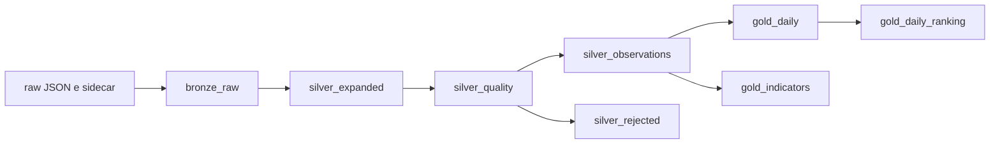

# Arquitetura da Fase 3

O `spark-pipeline.yml` registra oito visões materializadas no catálogo `spark_catalog.climatewatch_f3`. O `dry-run` valida o grafo; `run` materializa em armazenamento local persistente. O mesmo grafo é reexecutável para incorporar correções históricas presentes nos objetos raw.



## Contratos das camadas

- **Bronze:** bytes originais, hash SHA-256, caminho, fonte, lote, local, fuso, variáveis e instante de ingestão. O sidecar fornece proveniência; a transformação não chama a API.
- **Silver expandida:** uma linha por hora declarada no JSON, valores e unidades de origem, instante UTC calculado com o fuso IANA. Campos opcionais desconhecidos no corpo são ignorados pelo schema explícito.
- **Silver qualidade:** `quality_flags` documenta schema inválido, array desalinhado, unidade inválida e medidas ausentes ou fora de faixa. `silver_rejected` guarda essas linhas; `silver_observations` seleciona as válidas, converte unidades e resolve revisões por `ingested_at`, hash e lote.
- **Gold diária:** chave `(location_id, source, model, timezone_name, local_date)`, precipitação acumulada, temperatura média e máxima, horas observadas e esperadas, `incomplete_day`. Fontes e modelos nunca são somados entre si. `sum` e `avg` mantêm `NULL` quando todas as medidas são nulas.
- **Gold indicadores:** janela temporal `[t-23h, t]` por local/fonte/modelo, precipitação e temperatura móveis, contagens e `complete_24h_window`. Lacunas reduzem cobertura. `gold_daily_ranking` considera apenas dias completos e compara cobertura equivalente por fonte, modelo, dia e horas esperadas; empates compartilham posição.

O dia Gold segue o calendário local do registro, inclusive dias de 23 ou 25 horas em transições de horário de verão. A precipitação horária é atribuída ao rótulo de hora local vindo da fonte; consulte [ADR 0004](adr/0004-time-contract.md).

## Inspeção

No contêiner Spark, após `run`:

```python
from pyspark.sql import SparkSession
s = SparkSession.builder.getOrCreate()
s.sql("SELECT location_id, source, model, local_date, observed_hours, expected_hours, precipitation_mm, incomplete_day FROM climatewatch_f3.gold_daily").show()
s.sql("SELECT location_id, observed_at_utc, precipitation_24h_mm, complete_24h_window FROM climatewatch_f3.gold_indicators").show()
s.sql("SELECT location_id, local_date, precipitation_rank FROM climatewatch_f3.gold_daily_ranking").show()
s.sql("SELECT quality_flags, count(*) FROM climatewatch_f3.silver_rejected GROUP BY quality_flags").show(truncate=False)
```

## Comparação didática

Em PySpark imperativo, um programa teria de ler `bronze_raw`, aplicar `from_json`, `explode`, filtros, `row_number`, agregações e gravações de cada tabela, além de ordenar a execução e reconstruir dependências a cada replay. Aqui cada visão declara a consulta e a relação com a visão anterior. O runtime monta e executa o grafo; a lógica de parsing, rejeição, deduplicação e cobertura continua explícita no SQL. Não há comparação de desempenho medida.
