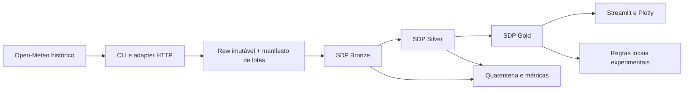

# ClimateWatch — plano de desenvolvimento

Data: 13/11/2026. Fonte de requisitos: [prompt original](../02_CLIMATEWATCH_PROMPT_CODEX.md).
Estado: planejamento local entregue; implementação não iniciada. Modelo solicitado para desenvolvimento: **gpt-6-luna, esforço médio**.

## 1. Autorização e método

Esta entrega planeja o projeto inteiro, sem implementar as fases seguintes. Não criar Issues, PRs, repositórios remotos, commits ou push nesta etapa. A solicitação atual de trabalho local prevalece sobre o fluxo remoto padrão da skill spec-orchestration. O planejamento usa documentos simples; não inicializa o gerenciador dessa skill, cujo gate de conclusão exige entrega remota. IDs abaixo são locais, não números de Issues. Quando houver autorização para GitHub, consultar Issues abertas e fechadas antes de atribuir títulos `[ATI-NNN]`, `[BUG-NNN]` ou `[DOC-NNN]`.

Executar somente a fase expressamente solicitada, em sequência, e parar ao final. O planejamento não constitui aprovação das propostas arquiteturais nem prova de viabilidade do runtime. Não trocar o modelo automaticamente. Se a tarefa exceder seu escopo, dividi-la ou registrar bloqueio técnico.

## 2. Objetivo, usuários e escopo

Laboratório reproduzível para estudante de engenharia de dados e leitor do portfólio: coletar histórico climático, explicar proveniência, tratar qualidade e explorar chuva e temperatura por localidade brasileira.

**MVP:** três localidades públicas verificadas; ao menos 30 dias consecutivos; quatro variáveis horárias; coleta batch incremental; raw auditável; SDP Bronze/Silver/Gold; mapa e séries temporais; limiares locais experimentais; testes offline e online separados; Docker; documentação e cinco rascunhos de posts. Sem dependência obrigatória de GPU, nuvem ou Databricks.

**Casos de uso:** baixar um intervalo; repetir sem duplicatas; recuperar lote interrompido; investigar rejeições; recalcular dias corrigidos; selecionar cidade/período no painel; explicar um indicador por sua origem; reproduzir a demonstração offline.

**Fora do MVP:** Kafka, processamento contínuo, INMET integrado, ML preditivo, forecast, S3/MinIO, Delta/Iceberg obrigatórios, cluster distribuído, autenticação multiusuário, produção e envio de notificações. Extensões são planejadas na seção 10, sem bloquear o MVP. O produto não é alerta oficial nem previsão de enchentes; 30 dias não sustentam conclusão de tendência climática.

## 3. Auditoria: existe / falta / comprovação

| Área | Existe em 13/11/2026 | Falta | Como comprovar depois |
|---|---|---|---|
| Requisitos | Prompt completo, ainda não rastreado no Git | Resolver decisões de execução | Revisar este plano e ADRs |
| Repositório | Branch `main`, commit `1d393c9`, README curto e `.gitignore` Python | Pacote, testes, lockfile, Compose | Instalação limpa e comandos reproduzíveis |
| Ambiente | Python local 3.12.12; executáveis Docker e Java encontrados | Validar versões, daemon, memória e compatibilidade | Inventário e PoC F1-02 |
| Dados | URLs documentais acessíveis | Consultas reais, coordenadas, catálogo e fixture | F1-03/F1-04/F1-09 |
| Pipeline/UI | Nenhum código | Todas as camadas | Fases 3 e 4 |
| Qualidade | Critérios no prompt | Testes e resultados | Relatórios por tarefa |
| Documentação | Prompt e README | Runbook, contratos, ADRs, Sphinx e posts | Fase 5 após código e testes |

Nenhuma dependência instalada, serviço iniciado ou base do projeto criada neste planejamento. A consulta ao Jota funcionou com execução permitida fora do sandbox; não exigiu iniciar serviços. Testes de runtime, ingestão e pipeline: **NÃO EXECUTADOS**.

## 4. Arquitetura proposta e contratos a estabilizar



Dependências: interfaces → aplicação → domínio; infraestrutura implementa adapters. Transformações Spark vivem fora do domínio. Funções declarativas retornam DataFrames, sem HTTP, escrita manual escondida, `collect` irrestrito ou mutação da sessão. Scripts são entradas finas.

Estrutura **prevista**, criada apenas conforme as tarefas:

```text
src/climatewatch/{domain,application,infrastructure,interfaces,pipelines}/
scripts/download_weather.py
spark-pipeline.yml
config/locations.json
contracts/                     # contratos versionados e exemplos
data/fixtures/                 # fixtures pequenas
data/raw/                     # não versionar downloads
data/warehouse/               # tabelas persistidas, não versionar
data/state/                   # manifesto e controle local
tests/{unit,contracts,integration,e2e}/
docs/{adr,evidence,linkedin}/
docs/{architecture,data-contracts,data-catalog,runbook,sources-and-licenses}.md
pyproject.toml, uv.lock, Dockerfile, docker-compose.yml, Makefile
```

Proposta: `uv` para ambiente e lock; PySpark para transformações; Streamlit/Plotly para consumo. Nenhum pandas na transformação do pipeline. Se uma biblioteca de apresentação exigir conversão tabular, limitar o volume e registrar justificativa. Sem banco relacional de negócio no MVP: manifesto local com escrita atômica e execução de um escritor por vez. Se surgir banco relacional, decidir migração e usar SQLAlchemy com sessões centralizadas.

### Contratos propostos (F1-05 confirma antes de consumidores)

- Localidade: ID estável, nome, UF, coordenadas verificadas, timezone IANA, URL e data da verificação. Candidatas: São Paulo/SP, Recife/PE e Manaus/AM; nomes são proposta, coordenadas não foram verificadas.
- Raw: bytes JSON originais, request_id, batch_id, parâmetros normalizados, hash, source, modelo solicitado/resolvido quando disponível, ingested_at UTC, status HTTP e versão do coletor. Requisições iguais e conteúdo igual reutilizam objeto; correções da origem preservam novas versões.
- Silver: formato largo, uma linha por `(location_id, measurement_time, source, model)`. Colunas `temperature_c`, `precipitation_mm`, `humidity_pct`, `wind_speed_kmh`, timezone, quality_flags, contract_version e proveniência. Modelo não identificado não pode ser inventado. Campos novos opcionais são tolerados; campo obrigatório ausente vai à quarentena.
- Tempo: armazenamento UTC; agrupamento por dia civil da localidade. Formalizar timestamp inicial/final do acumulado de chuva conforme a fonte. Não confundir instante da leitura com período do acumulado.
- Gold: chave `(location_id, local_date, source, model, metric_version)`; totais de chuva, temperatura média/máxima, cobertura e contagem esperada/recebida. Não transformar ausência em zero. Dias incompletos permanecem sinalizados; rankings só com cobertura e períodos comparáveis.
- Janela móvel: 24 horas de tempo decorrido, distinta de dia civil; dados insuficientes geram estado inconclusivo. Horário de verão: dias de 23/25 horas em fixture, sem exigir sempre 24 amostras.
- Correções: selecionar versão válida mais recente por ingested_at e desempate determinístico; reprocessar dias afetados e janelas dependentes. Não somar duplicatas nem prometer exactly-once na API.
- Quarentena: motivo, hash, lote, caminho raw, versão do contrato; corrigir e reprocessar sem apagar a origem.

### Decisões e compatibilidade

| Componente | Proposta | Gate antes de fixar |
|---|---|---|
| Sistema | Ubuntu 24.04 LTS como alvo do prompt | Registrar SO real e testar imagem |
| Python | 3.12, patch exato a fixar | Resolver lock + testes na imagem |
| Spark/PySpark/SDP | Distribuição open source com `pyspark.pipelines` e `spark-pipelines` | F1-02: import, CLI, dry-run, run e leitura persistida |
| Java/Scala/Hadoop | Versões compatíveis com a distribuição escolhida | Conferir documentação versionada e registrar runtime; sem JAR avulso improvisado |
| Armazenamento | Raw JSON e tabelas locais, Parquet como candidato | PoC de catálogo, persistência e reexecução; ADR antes da Bronze |
| Interface | Streamlit + Plotly | Fixar após smoke do leitor Gold |
| Qualidade | Ruff, mypy, pytest e pytest-cov | Lock e execução offline |
| Documentação | Sphinx após código e testes | Build com warnings como erro na fase 5 |

Não usar `latest` em imagens/lock finais. A URL Spark `latest` consultada é móvel e não prova que uma versão está instalada ou publicada no índice de pacotes usado. Não considerar Delta, Iceberg, expectativas DQ, Auto CDC ou conectores suportados sem teste específico. Se SDP não persistir corretamente com a combinação selecionada, bloquear F1-02, documentar erro mínimo e avaliar alternativa; PySpark imperativo pode servir como comparação, mas não satisfaz o aceite SDP.

ADRs previstos: 0001 batch sem Kafka (F2-01); 0002 SDP versus imperativo/Structured Streaming (F1-02, complementado F3-08); 0003 armazenamento e catálogo (F1-02); 0004 tempo, acumulados e correções (F1-05/F3-04). Estado inicial: **propostos**, não aprovados.

## 5. Recursos, download e operação

Orçamento inicial proposto, não medido: Spark local com 2 núcleos e limite de 4 GiB; dashboard até 1 GiB; reservar 10 GiB de disco para imagens/cache/dados e margem de 2 GiB no host. Inventariar disponibilidade antes de subir; não desligar outros projetos. Se não couber, reduzir amostra ou registrar bloqueio. GPU não participa.

Começar com fixture de 48–72 horas; backfill real de 30 dias apenas depois de uma consulta curta validada. Janelas propostas de 7 dias, um request por vez, orçamento interno de até 30 requests por execução incluindo retries, limite inicial de 10 MiB por resposta e 100 MiB por execução, configuráveis e inferiores aos limites do provedor. Medir tamanho real antes de ampliar. Nenhum download grande está autorizado automaticamente.

TTL proposto de 24 horas, relógio injetável em testes, bypass explícito para revisão da origem, timeout de conexão/leitura, no máximo 3 tentativas por request com backoff e Retry-After. Registrar falhas sem loops infinitos. Cache e manifesto têm responsabilidades distintas. Escritas temporárias e renomeação atômica; bloquear segundo escritor. Não limpar raw/checkpoints com comandos automáticos destrutivos.

Logs: correlation_id/request_id, batch_id, dataset, etapa, duração, status e rejeições; event_id só se houver evento. Métricas: volume recebido/aceito/rejeitado, throughput, duração, freshness distinguindo idade do dado histórico e atraso de coleta, cache hits, retries e retrabalho. Não confundir a idade de um backfill com falha operacional. Baselines serão medidos, sem metas numéricas de performance inventadas.

## 6. Regras para execução com Luna 6 médio

1. Uma tarefa por contexto de trabalho e um executor de cada vez. Ler apenas contrato, tarefa, relatório anterior e arquivos envolvidos; consultar o prompt completo quando houver conflito.
2. Cada tarefa tem uma entrega central, um grupo de arquivos e teste observável. Esforço P = alteração localizada; M = pequena integração. M não significa delegar arquitetura inteira ao modelo.
3. Preferir até 3 arquivos produtivos por tarefa, além de testes/documentação pertinentes. Se ultrapassar, registrar subtarefas antes de continuar; nunca esconder trabalho incompleto.
4. Consumidores não redefinem contratos. Decisão indefinida vira pergunta/bloqueio, com uma proposta e evidência mínima. Não mudar biblioteca ou modelo silenciosamente.
5. Executar testes locais da tarefa, depois regressões afetadas. Após duas tentativas sem progresso no mesmo erro, registrar reprodução e parar essa tarefa para diagnóstico.
6. Relatório persistente por ID em `docs/evidence/<ID>.md`: arquivos, comando exato, resultado, trecho da saída, critérios atendidos, limitações, próximos passos. O coordenador confere evidências antes de liberar dependências.
7. Estado local: PLANEJADA → EM EXECUÇÃO → VALIDADA LOCALMENTE, ou BLOQUEADA. Isso não representa entrega remota. Na retomada, conferir arquivos e relatórios, não confiar apenas no chat.
8. Ao terminar a fase, registrar resumo, aprendizado, changelog e parar. Não executar a próxima fase nem publicar automaticamente.

Modelo de pedido e relatório: [guia de execução](planning/execution-guide.md). Backlog detalhado: [tarefas](planning/backlog.md).

## 7. Fases e gates

| Fase | Resultado | Gate de saída | Post |
|---|---|---|---|
| 0 — Planejamento | Escopo, arquitetura proposta, riscos, backlog e pesquisa documental | Cobertura do prompt e pendências explícitas | Nenhum |
| 1 — Fonte e protótipo | Ambiente mínimo, PoC SDP isolada, contratos, fixture e coletor | Coleta offline testada; consulta real curta separada; PoC persistida | 1/5 |
| 2 — Resiliência batch | Cache, intervalos, manifesto, retomada e backfill | Falhas/replay sem perda silenciosa; 3 localidades × 30 dias verificados | 2/5 |
| 3 — SDP | Bronze, Silver, Gold e qualidade | dry-run + run + consultas; idempotência, DST, correções e lacunas | 3/5 |
| 4 — Produto | Dashboard, indicadores, métricas e demo | E2E offline; seleção local/período; transparência sobre dados | 4/5 |
| 5 — Consolidação | Suíte final, hardening, Sphinx e material editorial | Instalação limpa, build docs, relatório final e cinco rascunhos revisáveis | 5/5 |

A fase 1 antecipa uma PoC SDP pequena para reduzir o risco de descobrir incompatibilidade apenas na fase 3. Não antecipa o pipeline completo. Offline permite desenvolver sem API, mas não substitui o aceite real de 30 dias. Rede indisponível deixa esse aceite pendente.

## 8. Estratégia de validação e rastreabilidade

| Requisito | Tarefas principais | Evidência exigida |
|---|---|---|
| 3 localidades / 30 dias | F1-03, F2-06 | Catálogo com fonte, parâmetros e cobertura real |
| Downloader e origem íntegra | F1-06 a F1-09, F2-02 | Bytes/hash, cache e HTTP simulado |
| Reexecução sem duplicar | F2-03 a F2-05, F3-07 | Contagens, chaves únicas e comparação de valores |
| UTC, fusos e DST | F1-05, F3-04 | Fixture com datas conhecidas e dias 23/25h |
| Totais corretos | F3-05 | Conta manual independente, nulos e virada do dia |
| SDP real | F1-02, F3-01 a F3-08 | CLI + resultado persistido, não só dry-run |
| Mapa e séries | F4-01 a F4-03 | Smoke e inspeção visual com amostra conhecida |
| Limiares e limites científicos | F4-04, F5-05 | Testes de fronteira e aviso experimental |
| Observabilidade e recuperação | F2-04/F2-05, F4-05 | Falha injetada, logs e runbook |
| Offline e arquitetura | F1-04, F1-05, F4-06 | HTTP bloqueado nos testes offline; imports verificados |
| Qualidade final e documentação | F5-01 a F5-07 | Suíte, cobertura reportada, Sphinx e evidências editoriais |

Três níveis: unitários puros; contratos/HTTP simulado; integração Spark e E2E isolados. Online é opt-in e nunca requisito para testes unitários. Fixture sintética identifica explicitamente sua origem; payload real pequeno exige atribuição e hash. Falhas obrigatórias: 429, timeout, 5xx, 4xx não recuperável, JSON inválido, arrays de tamanhos diferentes, campo ausente, duplicata, atraso, mudança de unidade, falta de hora, escrita interrompida e disco sem espaço simulado.

## 9. Riscos e pendências

| Risco/decisão | Tratamento | Responsável pela resolução |
|---|---|---|
| Compatibilidade SDP/catálogo | PoC bloqueante e versões exatas antes do pipeline | Executor F1-02, conferência coordenador |
| Termos da API e uso de portfólio | Registrar termos; reavaliar se uso comercial/promocional | F1-03 e revisão editorial F5-05 |
| Coordenadas e escolha das cidades | Verificar país/UF/timezone; conservar evidência | F1-03 |
| Semântica do acumulado horário | Definir intervalos e teste de fronteira | F1-05/F3-04 |
| Fonte corrige o histórico | Versionar raw e recalcular dependências | F2-03/F3-07 |
| Máquina sem recursos | Inventário e limitação de Compose | F1-01/F1-02 |
| Escopo excessivo para uma sessão Luna | Tarefas pequenas, relatórios e retomada | Coordenador em cada tarefa |
| Rede bloqueada | Fixture para desenvolver; aceite real pendente | F1-09/F2-06 |
| Publicação não autorizada | Entregas locais, nenhuma escrita GitHub/LinkedIn | Todas as fases |

Não há pergunta bloqueante para entregar este planejamento. Cidades, gerenciador, armazenamento e recursos são propostas revisáveis; versões finais dependem dos testes.

## 10. Evoluções opcionais após o MVP

Cada extensão exige pedido próprio e decomposição equivalente antes de execução.

| ID | Extensão | Sequência pequena proposta | Gate |
|---|---|---|---|
| EXT-01 | Comparar INMET | Verificar licença/estação → parser de amostra → alinhar tempo/unidade → MAE e cobertura → gráfico | Não misturar grade com estação; MAPE só com denominador adequado |
| EXT-02 | Forecast | Verificar endpoint → contrato separado por emissão/validade → fixture → comparar com histórico | Sem vazamento temporal ou chamar reanálise de previsão |
| EXT-03 | Kafka | ADR com necessidade real → PoC conectores → producer → replay → integração | Benefício medido, JARs compatíveis, event time/watermarks testados |
| EXT-04 | ML | Pergunta/target → baseline ingênuo → split temporal → treino → avaliação | Superar ou explicar baseline; nenhum claim hidrológico |
| EXT-05 | Escala/armazenamento | Medir gargalo → ampliar catálogo → PoC formato → migração reversível → benchmark | Volume, custo, correção e recuperação comprovados |

## 11. Fontes consultadas

Consulta documental em 13/11/2026, sem download meteorológico nesta etapa:

- [Open-Meteo histórico](https://open-meteo.com/en/docs/historical-weather-api): fonte baseada em modelos/reanálise; contrato e parâmetros ainda precisam de consulta de amostra.
- [Termos Open-Meteo](https://open-meteo.com/en/terms): API gratuita restrita a uso não comercial, atribuição CC BY 4.0 e limites publicados. Verificar novamente antes da coleta e publicação.
- [Geocoding](https://open-meteo.com/en/docs/geocoding-api): mecanismo proposto para verificar localidades; nenhuma coordenada aprovada nesta entrega.
- [Forecast](https://open-meteo.com/en/docs): documentação distinta, reservada à extensão.
- [INMET](https://portal.inmet.gov.br/dadoshistoricos): portal localizado; arquivos, esquema e termos de redistribuição ainda a validar.
- [Spark SDP](https://spark.apache.org/docs/latest/declarative-pipelines-programming-guide.html): definições declarativas e CLI documentadas. Compatibilidade local não comprovada. Referência versionada deverá substituir `latest` no ADR final.

## 12. Situação da entrega

F0-01 (auditoria), F0-02 (pesquisa documental) e F0-03 (plano/backlog) entregues localmente. PoC executável, downloads e testes de software estão planejados, não realizados. A próxima etapa possível, mediante pedido, é `Execute somente a FASE 1 do docs/plan.md, com Luna 6 médio; siga docs/planning/backlog.md, registre evidências e pare ao final. Não publique no GitHub.`
